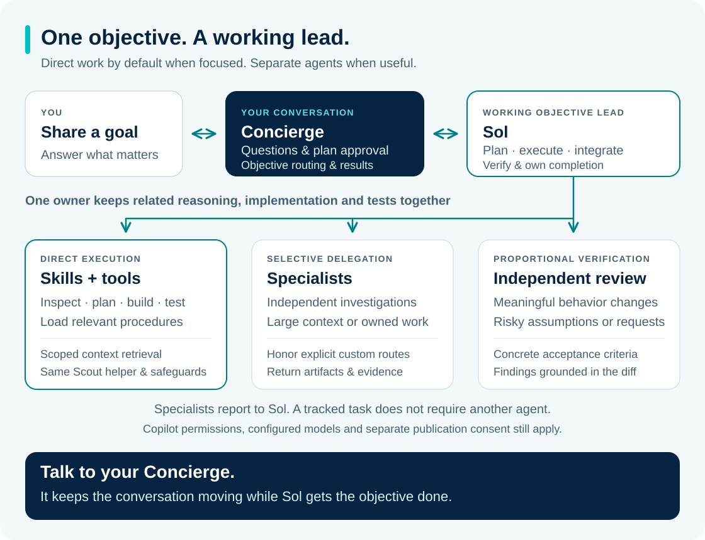

# Concierge


Tell Concierge what you want to get done. Its objective lead plans, does focused work directly, brings in specialists when useful, and comes back with results you can check.

Concierge is a native plugin for **GitHub Copilot CLI and the GitHub Copilot app**. It uses Copilot's agents, skills and permissions. You need a signed-in Copilot account with access to the configured models; the defaults are GPT-6 Luna and GPT-6.1 Sol.

**0.7.0** makes Sol a working objective lead: it can investigate, plan, implement and verify directly within approved scope. Specialists remain available for independent work, substantial discovery, explicit custom routes and proportional review. Structured approvals and learning safeguards remain in place.

## Get started

From your project folder:

```sh
copilot plugin marketplace add goldsziggy/copilot-concierge
copilot plugin install copilot-concierge@copilot-concierge
copilot --agent copilot-concierge:concierge
```

Then give it a goal:

> Make the basket screen easier to use. Follow our existing design system, show me the plan, then implement it and run the relevant tests.

**In the app:** open **Customize → Plugins**, add the `goldsziggy/copilot-concierge` marketplace and install **copilot-concierge**. Open your project, select **concierge** in the agent picker and **GPT-6 Luna** in the model picker, then send your request. Restart the app if a CLI installation does not appear.

Upgrading from 0.4? The entry agent is now **concierge**, replacing **frontdesk**. Update shortcuts and start a fresh session. [Install, update and migrate →](references/install.md)

## A small team behind one conversation



You stay in one conversation. Concierge relays questions, shows the plan and keeps you updated. Sol, its objective lead, follows the project instructions and owns the plan, execution, integration and completion claim. A tracked task can be done directly or by a specialist; a one-file question does not require a worker.

Sol loads relevant procedures as skills. A cohesive feature can stay with one owner across React, Node.js, GraphQL and its tests. Delegation needs a useful reason: independent investigation, substantial context, separate implementation ownership, independent verification or an explicit custom agent/model requirement. Existing routing rows remain delegation instructions, including rows that name a shipped agent.

- **Scout** handles substantial repository, document and ticket discovery. Sol can do focused retrieval by loading the same Scout skill and using its helper. Both preserve private preferences and verified repository knowledge in the existing separate stores.
- **Planning and design** skills guide direct work; specialists help with substantial requirements investigations, independent challenges and design work.
- **Implementation and review** specialists cover bounded assignments and independent checks. The implementation owner keeps code and its tests together. Review is proportional to risk, with an independent reviewer for meaningful behavior changes, risky assumptions or explicit review requests. An escalation role is available when more help is needed.

Ticket access depends on your existing integrations. Concierge does not bundle a ticket connector or provider credentials.

## On-demand procedures

- **Debugging** reproduces faults, tests competing explanations and verifies a minimal fix across affected layers.
- **Task evaluation** compares baseline and candidate outcomes, constraints, elapsed work and actual usage using repeatable trials. Live trials require an explicit budget; it does not run them automatically.

These are skills the execution owner loads when useful, not additional agents or mandatory routing stages. [Comparative evaluation →](references/comparative-evaluation.md)

## You're in control

Concierge asks you to approve a short plan by default, with separate Plan, Scope, Steps, Checks and optional Watch-outs sections. Choose Approve, Change something or Cancel; a revised plan needs a new approval. Say “go ahead without asking” to skip that pause, or set `{"planApproval":"auto"}` in `.copilot-concierge/config.json`. Copilot's tool permissions still apply. [Approval settings →](references/approval-preference.md)

**Ship it is optional.** After verified implementation, Concierge can offer to prepare a draft GitHub pull request or GitLab merge request. Accepting starts read-only preflight. Creating the draft requires a separate confirmation of the exact destination, commits, title and body. Ship it uses an existing authorized integration or CLI; it stops if the destination, access or draft capability is unclear. It does not commit, push or merge. Ship it runs through Concierge's orchestrator, not as a standalone skill. [Shipping details →](references/handoff.md#optional-ship-it-decisions)

## What Concierge learns

**Memories are about how you like to work.** Say “Remember that I prefer a short summary, then details.” Concierge can use that preference in your other projects on the same computer. It keeps a small private file outside Git repositories, rather than saving conversations or a history of your tasks. It asks before saving a preference inferred from a pattern in your usage.

**Knowledge is about the project.** Sol or Scout uses the same learning procedure to record verified tech stacks, conventions, business rules, findings and code decisions in `docs/concierge/knowledge.md`, with source references and dates. For example: “Document why we use integer cents for prices.” Knowledge stays with the repository and can be reviewed and included deliberately in a relevant commit when you've authorized committing. Existing documentation is preserved; Concierge changes only its own clearly marked section.

You can say “What do you remember about me?”, “Forget my preference for short answers”, “Stop remembering my preferences” or “Correct that project rule.” Current instructions and current source evidence always take precedence. Private preferences, personal information and secrets do not belong in repository knowledge. Approval and security settings stay in their existing controls, separate from memory.

Say “Do not write any files” to keep both kinds of learning in the current session. Persistent learning needs Node.js 20+ and Git; when unavailable or access is denied, Concierge continues without saving. On Windows, persistence uses a bundled Windows PowerShell 5.1 adapter on local NTFS drives, and its native tests pass in CI. Windows client editions block that script under their default execution policy, so learning stays session-only there unless local scripts are already allowed. [Memory, knowledge and migration details →](references/memory-and-knowledge.md)

## Make it yours

Add your organization's agents, skills and routing rules without changing Concierge. Each guide covers file locations, a copyable example, discovery, verification, troubleshooting and what is not supported:

- [Customization quick start](references/customizing.md): add a team reviewer and rules in four steps, then share them as a team plugin.
- [Custom agents](references/custom-agents.md): specialist profiles with one required model, tools and a charter.
- [Routing charters](references/routing-charters.md): tell Concierge which agent and skills handle each role.
- [Skills](references/custom-skills.md): reusable guidance for Sol, Concierge's workers or your own.

Roles use one explicitly configured model with Copilot's required-model policy; an unavailable model is reported. The app's root session model still needs attention in its model picker. [Model configuration →](references/install.md#session-local-launcher)

## Verification and limits

Source checks, installation checks and live model sessions are different kinds of evidence. The 0.7.0 direct-work policy has not yet been accepted in live Copilot trials, and no cost or latency improvement is claimed. Comparative scenarios measure accepted outcomes, constraints, evidence, retries and full cost rather than delegation counts alone. [Runtime verification](references/runtime-verification.md) records their scope, including historical sessions under the old Zilot name. The [capability matrix](references/capability-matrix.md) covers host differences. The published 0.5.0 app smoke tests exercised the earlier local project-note creation and refresh, plus a Ship it preflight that stopped safely on a repository without a remote or commits. Those sessions do not verify the current memory/knowledge behavior or structured approval display. Source-contract checks cover the approval decisions and fallback; see runtime verification for host evidence. Live draft creation on GitHub and GitLab, and Windows/Linux model workflows, remain unverified.

The plugin is available through its own marketplace above. An Awesome Copilot listing requires separate maintainer approval and publication.

## Working on Concierge

```sh
npm test
npm run validate
npm run catalog:check
npm run package
```

These source checks make no model calls. Packaging creates a versioned ZIP and checksum under `dist/`. Live Copilot trials use your account's credits.

[Install and remove](references/install.md) · [Sample requests](examples/requests.md) · [Handoff contract](references/handoff.md) · [Distribution](references/distribution.md) · [Release process](references/releasing.md) · [Migration from Zilot](references/migration.md)

## License

Copyright 2026 goldsziggy. The plugin, documentation and included artwork are licensed under [Apache-2.0](LICENSE). See [NOTICE](NOTICE).
